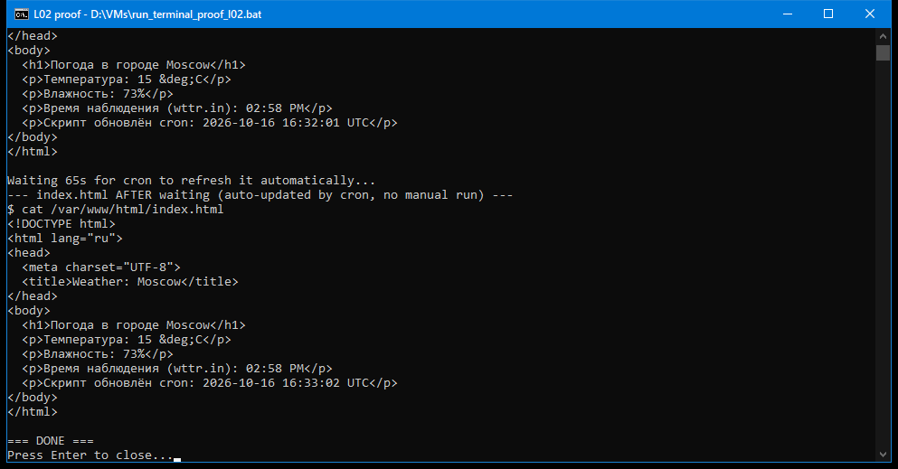

# Л02 — Автоматизация Linux: weather script + nginx + cron

Задание: написать bash-скрипт, который принимает в качестве входящего параметра
город, получает текущую температуру и влажность в этом городе через
[wttr.in](https://github.com/chubin/wttr.in) (JSON-формат, `jq` для парсинга),
и выводит результат в `index.html` дефолтного сайта nginx. Скрипт должен
запускаться автоматически по cron раз в минуту.

## Стек

- Ubuntu Server 24.04.5 LTS (VirtualBox VM, `devops-control`)
- nginx (дефолтный сайт, `/var/www/html/index.html`)
- `curl` + `jq` для запроса и парсинга JSON от wttr.in
- `cron` (crontab пользователя) — запуск раз в минуту

## Скрипт: `weather.sh`

```bash
#!/bin/bash
# weather.sh - fetch current temperature and humidity for a city from wttr.in
# and render them into the default nginx site's index.html.
#
# Usage: ./weather.sh <city>
#
# Requires: curl, jq

set -euo pipefail

CITY="${1:-Moscow}"
INDEX_FILE="/var/www/html/index.html"

WEATHER_JSON="$(curl -s "wttr.in/${CITY}?format=j1")"

TEMP_C="$(echo "$WEATHER_JSON" | jq -r '.current_condition[0].temp_C')"
HUMIDITY="$(echo "$WEATHER_JSON" | jq -r '.current_condition[0].humidity')"
OBS_TIME="$(echo "$WEATHER_JSON" | jq -r '.current_condition[0].observation_time')"
NOW="$(date '+%Y-%m-%d %H:%M:%S %Z')"

cat > "$INDEX_FILE" <<HTML
<!DOCTYPE html>
<html lang="ru">
<head>
  <meta charset="UTF-8">
  <title>Weather: ${CITY}</title>
</head>
<body>
  <h1>Погода в городе ${CITY}</h1>
  <p>Температура: ${TEMP_C} &deg;C</p>
  <p>Влажность: ${HUMIDITY}%</p>
  <p>Время наблюдения (wttr.in): ${OBS_TIME}</p>
  <p>Скрипт обновлён cron: ${NOW}</p>
</body>
</html>
HTML
```

Примечание: в примере из лекции использовалось поле `localObsDateTime`, но в
реальном ответе текущего API wttr.in оно пустое (`null`); актуальное и
присутствующее поле — `current_condition[0].observation_time`, оно и
используется в скрипте.

## Установка и развёртывание

```bash
sudo apt-get update
sudo apt-get install -y nginx jq

# скрипт лежит в /home/andrey/weather.sh
chmod +x /home/andrey/weather.sh

# дефолтный index.html должен существовать и быть доступен на запись cron-джобе
sudo touch /var/www/html/index.html
sudo chmod a+w /var/www/html/index.html

sudo systemctl enable --now nginx

# разовый запуск для проверки
/home/andrey/weather.sh Moscow
```

## Автоматизация через cron

```bash
(crontab -l 2>/dev/null | grep -v weather.sh; \
 echo "* * * * * /home/andrey/weather.sh Moscow > /dev/null 2>&1") | crontab -
```

Проверка установленной задачи:

```bash
$ crontab -l
* * * * * /home/andrey/weather.sh Moscow > /dev/null 2>&1
```

## Проверка результата

Страница доступна в браузере на хосте через NAT port forward VirtualBox:
`http://127.0.0.1:8080` → порт 80 ВМ.

### Скриншот 1 — страница в браузере


### Скриншот 2 — доказательство автоматического обновления по cron

SSH-сессия: показывает содержимое `index.html` **до** ожидания и **после**
ожидания 65 секунд, без единого ручного запуска скрипта между замерами.
Видно, что строка `Скрипт обновлён cron: ...` продвинулась с `16:32:01 UTC`
на `16:33:02 UTC` сама по себе — значит, файл реально переписывается планировщиком
cron, а не вручную.



## Итог

- ✅ bash-скрипт принимает город параметром (по умолчанию Moscow)
- ✅ получает температуру и влажность через wttr.in JSON + jq
- ✅ nginx установлен и раздаёт `/var/www/html/index.html`
- ✅ cron запускает скрипт раз в минуту, автоматическое обновление подтверждено
